<p align="center">
  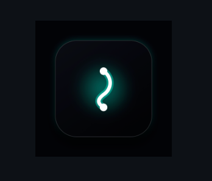
</p>

<h1 align="center">FixMySpine</h1>

<p align="center">
  AirPods posture intelligence for macOS.<br>
  100% Free &amp; Open-Source · Runs entirely on your Mac.
</p>

<p align="center">
  <a href="https://github.com/ombichave999/FixMySpine/releases/tag/v5.0.4">Download</a> ·
  <a href="#everything-it-does">Features</a> ·
  <a href="#how-it-works">How It Works</a> ·
  <a href="#private-by-default">Privacy</a> ·
  <a href="#supported-hardware">Hardware</a> ·
  <a href="https://buymeacoffee.com/fixmyspine">Buy Me a Coffee</a>
</p>

<p align="center">
  <a href="https://github.com/ombichave999/FixMySpine/releases/tag/v5.0.4"></a>
  <a href="https://developer.apple.com/macos/"></a>
  <a href="https://swift.org"></a>
  <a href="#private-by-default"></a>
  <a href="LICENSE"></a>
  <a href="https://buymeacoffee.com/fixmyspine"></a>
</p>

<p align="center">
  <a href="https://github.com/ombichave999/FixMySpine/releases/download/v5.0.4/FixMySpine.dmg">
    
  </a>
  &nbsp;&nbsp;
  <a href="https://buymeacoffee.com/fixmyspine" target="_blank" rel="noopener">
    
  </a>
</p>

<div align="center">
<table>
  <tr>
    <td width="25%" align="center">
      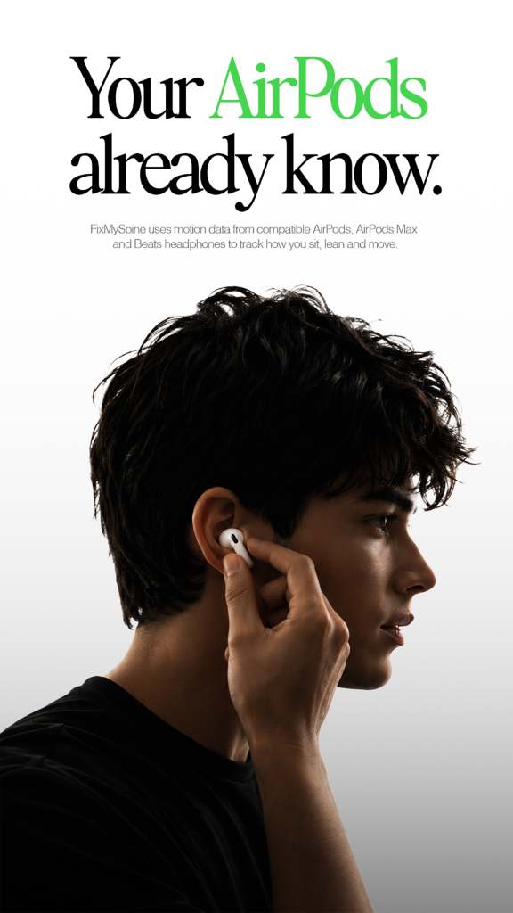
    </td>
    <td width="25%" align="center">
      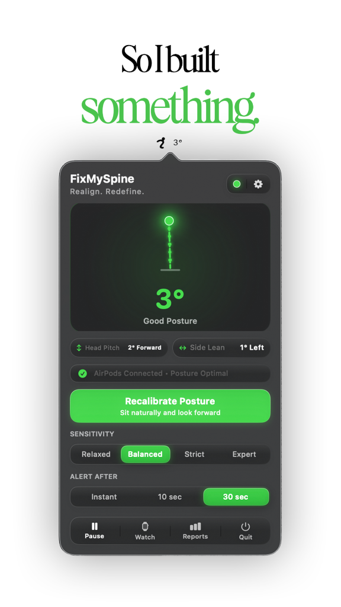
    </td>
    <td width="25%" align="center">
      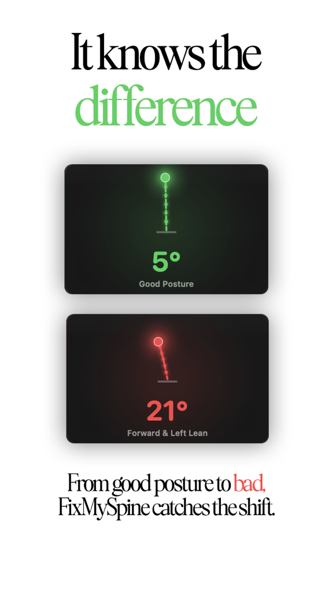
    </td>
    <td width="25%" align="center">
      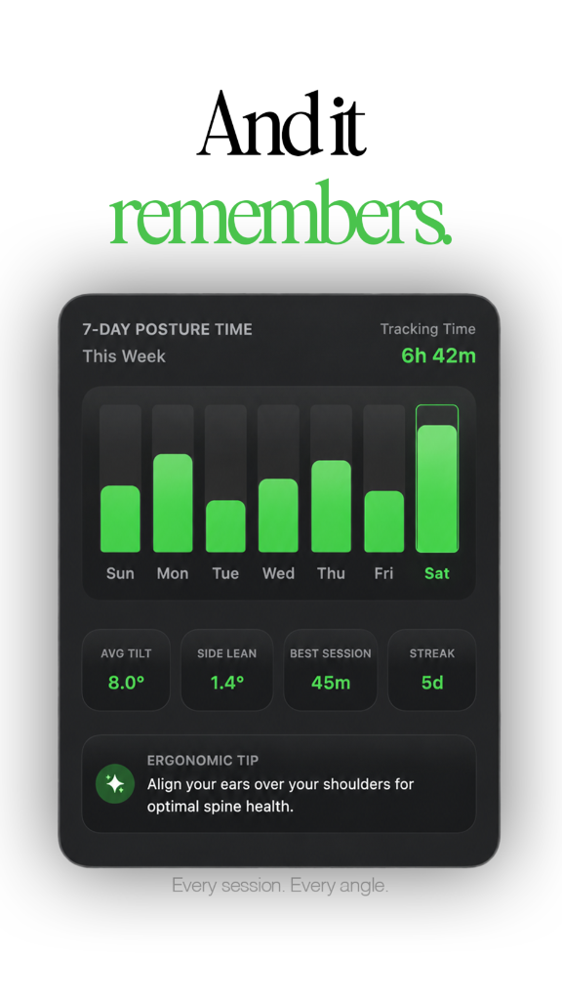
    </td>
  </tr>
</table>
</div>

Real-time 60Hz AirPods motion tracking, subtle in-ear alerts, intelligent slouch hysteresis, Apple Watch haptic taps, daily posture scoring, and native SwiftUI custom accents. The posture intelligence tools Mac users need during deep focus work, behind a featherlight menu bar icon with no camera access, no account, no telemetry, and no subscription.

## The app

Real UI, captured on the developer's Mac. The settings screen shows v4.3.7; appearance may vary by app version.

<table align="center">
  <tr>
    <td width="25%" align="center">
      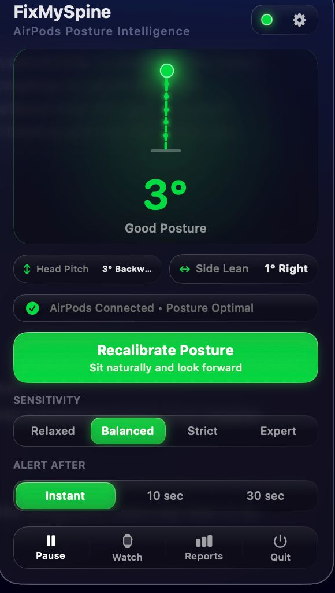
    </td>
    <td width="25%" align="center">
      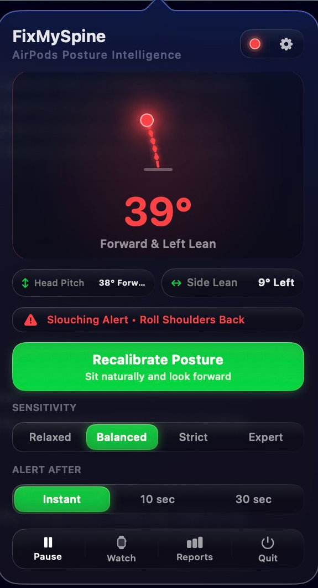
    </td>
    <td width="25%" align="center">
      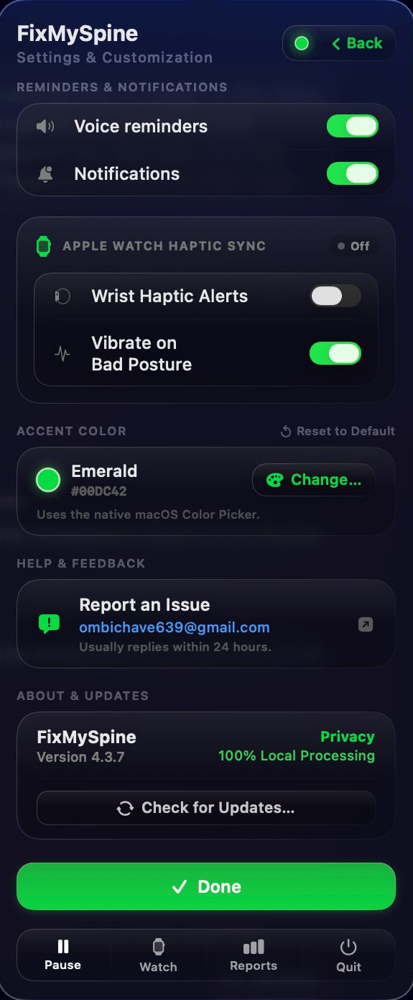
    </td>
    <td width="25%" align="center">
      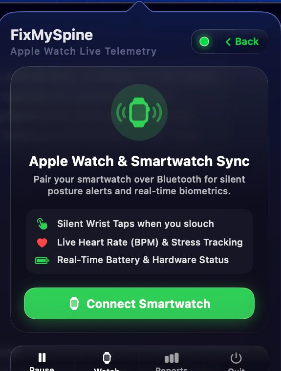
    </td>
  </tr>
</table>

## Everything it does

### Posture Intelligence & Kinematics

- **AirPods 60Hz motion stream.** Directly reads 3-axis angular velocity and head tilt via Apple's `CMHeadphoneMotionManager` API over Bluetooth Low Energy.
- **Intelligent slouch hysteresis.** Uses compound vector mathematics ($\sqrt{\text{pitch}^2 + 0.49 \times \text{roll}^2}$) to accurately isolate cervical slouching without false alarms when sipping water, stretching, or turning your head.
- **One-tap neutral baseline.** Calibrate your unique natural working posture — desk height, screen angle, and body anatomy. Every measurement is relative to you.
- **Sensitivity presets.** Choose between Relaxed (18°), Balanced (12°), Strict (8°), and Expert (5°) depending on your ergonomics goals.

### Alerts & Ambient Feedback

- **Discreet spoken cues.** Soft, calm audio cues like *"Time to reset your posture"* or *"Lift your chin slightly"* reset your shoulders without breaking focus.
- **Ambient in-ear chimes.** Gentle spatial audio tones sound only when slouching persists past your grace window.
- **Customizable grace window.** Adjust how long slouching must persist before you are nudged (Instant 3s, 10s, 30s). Glancing down or reaching for a notepad never rings the bell.

### Hardware & Telemetry

- **Apple Watch & BLE haptics.** Pair any Bluetooth LE smartwatch (Apple Watch, Garmin, Wear OS) for silent wrist taps during meetings or open-office focus sessions.
- **Weekly posture analytics.** Track daily posture scores, average tilt, daily slouch time, and discipline streaks — stored 100% locally in `UserDefaults`.
- **Liquid glass appearance.** Dressed to match macOS with dark glassmorphism styling and custom accent colors (Apple Green, Electric Blue, Purple, Orange, Pink).
- **Sparkle 2 auto-updates.** Native in-app updates verified against cryptographic Ed25519 signatures.

## How it works

Every head-tracking AirPod carries an Inertial Measurement Unit (IMU) built for spatial audio. FixMySpine streams that signal at 60Hz through Apple's CoreMotion framework:

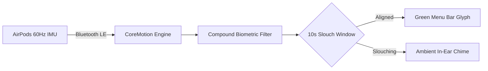

## Install

Grab the disk image from the [releases page](https://github.com/ombichave999/FixMySpine/releases) and drag FixMySpine into Applications:

<p align="center">
  <a href="https://github.com/ombichave999/FixMySpine/releases/download/v5.0.4/FixMySpine.dmg">
    
  </a>
</p>

Builds are signed and hardened for macOS Sonoma and Sequoia compatibility.

## Private by default

FixMySpine is built with privacy as an absolute foundational constraint:

<p align="center">
  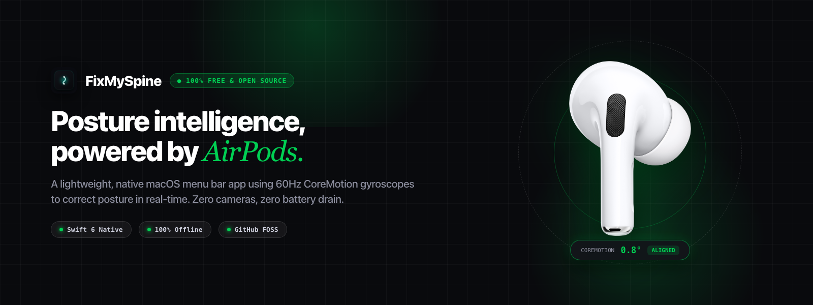
</p>

| Permission / Sensor | Status | Why |
| :--- | :---: | :--- |
| **Camera** | ❌ Never Used | 0% camera access. We never touch or request your webcam. |
| **Microphone** | ❌ Never Used | CoreMotion reads spatial motion sensors only, never audio. |
| **Network & Cloud** | ❌ Zero Calls | No accounts, no servers, no analytics. All math runs in local CPU memory. |
| **Bluetooth LE** | ✅ Local Only | Reads standard Apple AirPods motion telemetry. |
| **Notifications** | ⚡ Optional | Delivers posture alerts if voice cues are muted. |

## Supported hardware

FixMySpine works with any Apple audio device equipped with head-tracking IMUs running on macOS 14.0+:

| Device | Head-Tracking IMU | Status |
| :--- | :---: | :--- |
| **AirPods Pro (2nd Generation)** | 60Hz 3-Axis Gyroscope | ✅ Fully Supported |
| **AirPods Pro (1st Generation)** | 60Hz 3-Axis Gyroscope | ✅ Fully Supported |
| **AirPods Max** | 60Hz 3-Axis Gyroscope | ✅ Fully Supported |
| **AirPods (3rd & 4th Generation)** | 60Hz 3-Axis Gyroscope | ✅ Fully Supported |
| **Beats Fit Pro** | 60Hz 3-Axis Gyroscope | ✅ Fully Supported |
| **Beats Solo 4** | 60Hz 3-Axis Gyroscope | ✅ Fully Supported |

*Note: AirPods must be connected and actively worn (playing audio or in ANC/transparency mode) for macOS CoreMotion headphone telemetry to stream.*

## What you need

- A Mac (Apple Silicon or Intel)
- macOS 14.0 Sonoma or newer

### Build it yourself

```bash
# Clone the repository
git clone https://github.com/ombichave999/FixMySpine.git
cd FixMySpine

# Compile native macOS application bundle (Swift 6)
bash build.sh 5.0.4 release

# Launch FixMySpine
open build/FixMySpine.app

# Package standalone release DMG
bash make_dmg.sh 5.0.4 release
```

## Community & Support

FixMySpine is **100% Free and Open-Source**. If it helps protect your neck and posture during long coding sessions, consider supporting development:

<p align="center">
  <a href="https://buymeacoffee.com/fixmyspine">
    
  </a>
  &nbsp;&nbsp;
  <a href="https://github.com/sponsors/ombichave999">
    
  </a>
</p>

For private feedback or questions, contact [ombichave639@gmail.com](mailto:ombichave639@gmail.com).

## License

Distributed under the [MIT License](LICENSE).


